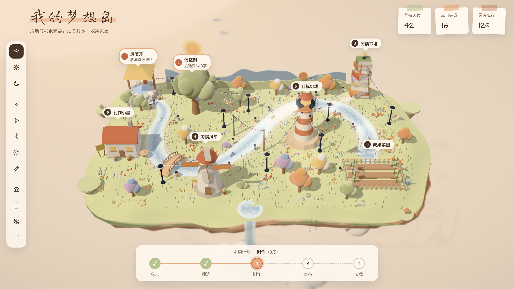
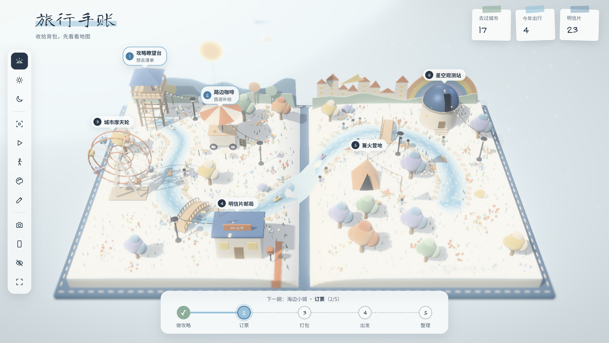
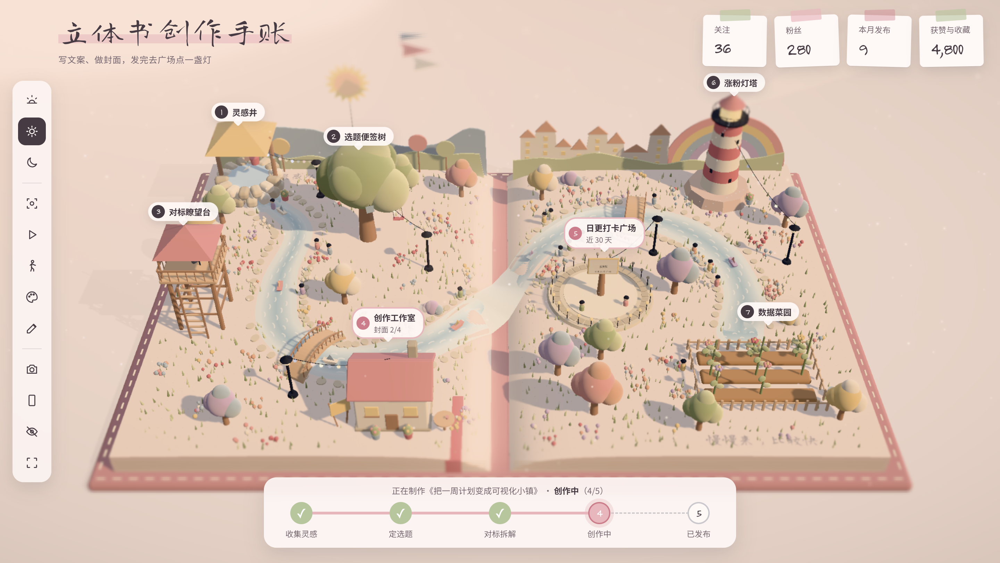
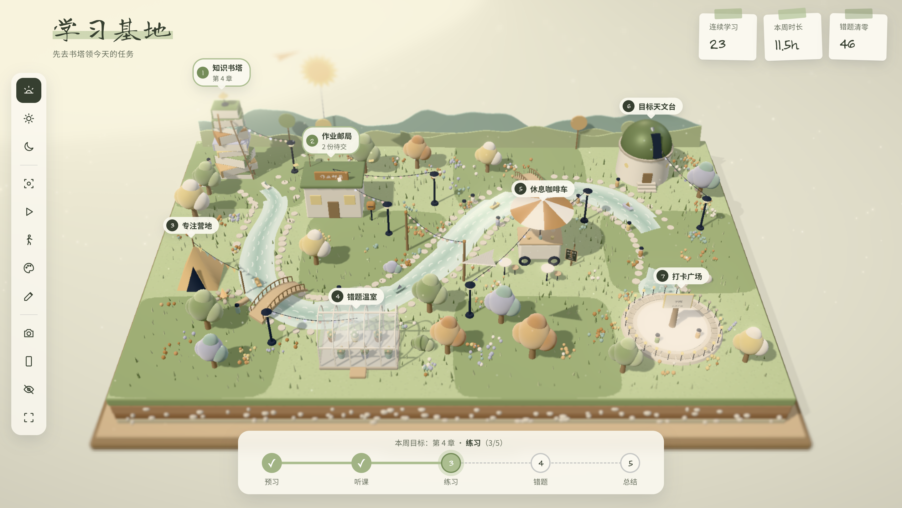
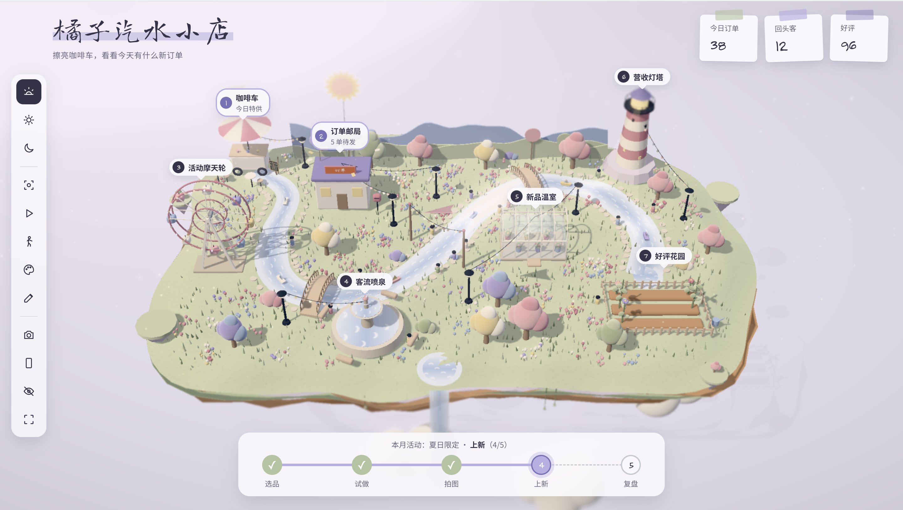

# build-3d-workbench

把计划、习惯、作品和日常记录，变成一座可以点击、漫步、换色的 3D 小世界。

这是一个面向编码助手的 skill：先将需求整理成 JSON 配置，再用现成的 Three.js 模板生成 HTML。主要通过选择底座、配色、建筑和填写内容完成定制，减少对模型从零编写 3D 场景能力的依赖。

支持 3 种底座、7 套内置配色、16 种建筑积木，以及昼夜切换、人物漫步、自动巡游、详情面板、本地编辑和截图。



图中数字、清单和业务内容为示例。底座、建筑组合和配色可独立修改，截图展示的配色不限定对应预设的默认主题。

## 目录

- [效果展示](#效果展示)
- [可以做什么](#可以做什么)
- [快速开始](#快速开始)
- [可直接复制的提示词](#可直接复制的提示词)
- [打开与操作](#打开与操作)
- [配色与底座](#配色与底座)
- [建筑积木](#建筑积木)
- [配置说明](#配置说明)
- [本地编辑与保存](#本地编辑与保存)
- [截图录屏与比例](#截图录屏与比例)
- [生成与检查](#生成与检查)
- [目录与技术栈](#目录与技术栈)
- [常见问题](#常见问题)
- [示例与隐私边界](#示例与隐私边界)

## 效果展示

同一套模板可以组合成旅行记录、创作手账、学习基地和小店看板。

### 旅行手账 · 立体书



### 内容创作 · 立体书



### 学习基地 · 方块沙盘



### 小店经营 · 漂浮岛



上方首图为漂浮岛成长工作台，共 5 张示例图。图片使用相对路径引用，分享或上传时请一起保留 `imgs/` 文件夹。

## 可以做什么

| 能力 | 说明 |
|---|---|
| 配置生成 | 把用途、区域、数字和流程整理成 JSON，脚本生成单个 HTML |
| 多种底座 | 立体书、漂浮岛、方块沙盘 |
| 主题切换 | 7 套内置配色，按 `T` 实时切换；支持自定义色板 |
| 建筑组合 | 16 种积木，支持 1～9 个区域，常规建议 3～7 个 |
| 自动摆放 | 不填写 `pos` 时按预设空位布置；自定义河道、较大缩放等仍需检查 |
| 内容面板 | 说明、数字卡、进度条、列表、勾选清单、长文本、标签 |
| 数据联动 | 灯塔亮窗、广场亮灯、风车转速、便签数量、菜园植物数量 |
| 环境切换 | 晨间、午后、深夜，天空、灯光、窗户和串灯一起变化 |
| 浏览与漫步 | 鼠标浏览、区域特写、自动巡游、可操控人物 |
| 本地编辑 | 页面内修改文字、数字与 JSON，使用浏览器 localStorage 保存 |
| 画面输出 | 保存纯 3D PNG、切换取景参考框、隐藏界面辅助录屏 |
| 低画质模式 | 减少花草，降低阴影开销，关闭泛光和移轴 |
| 检查工具 | 配置校验、静态 HTML 检查、可选 JS 语法检查和浏览器检查脚本 |

## 快速开始

### 方式一：交给编码助手

把整个 `build-3d-workbench/` 文件夹放到编码助手能够读取的位置，并让它加载这个 skill。不同工具的技能加载方式不同，也可以直接告诉助手 `SKILL.md` 的实际位置。

请保留 `assets/`、`scripts/` 和 `references/`，不要只复制 `SKILL.md`；完整模板和生成脚本就在这些目录里。

然后发送：

```text
用 build-3d-workbench skill，做一个 3D 工作台。
用默认预设生成，校验通过后把 HTML 给我，告诉我怎么打开。
```

默认从 `island-dream` 预设开始。有具体需求时，使用下一节的完整提示词。

### 方式二：直接运行脚本

在 skill 根目录执行。生成需要 Python 3，使用标准库，无需安装 Python 依赖；Node.js 可选，用于 JavaScript 语法检查。

```bash
# 列出所有预设、底座、主题和积木
python3 scripts/build_workbench.py --list

# 生成默认漂浮岛
python3 scripts/build_workbench.py \
  --preset island-dream \
  --output out/workbench.html

# 校验输出
python3 scripts/validate_workbench.py out/workbench.html
```

也可以先浏览 `examples/` 中已经生成的 5 份 HTML 示例，依赖的 Three.js 和字体仍需联网加载。

## 可直接复制的提示词

下面是一份完整的自律工作台需求，可以直接复制给已加载本 skill 的编码助手：

```text
用 build-3d-workbench skill 帮我生成一个 3D 工作台。

【用途】记录我的自律计划
【底座】漂浮岛（不确定就让你选）
【配色】抹茶绿
【标题】我的自律岛　【副标题】每天一点点，岛会慢慢长大
【区域】（每行：名字 —— 代表什么 —— 面板里放什么）
- 习惯风车 —— 每日习惯 —— 清单：早起、运动、阅读
- 目标灯塔 —— 年度目标 —— 进度 45%
- 阅读书塔 —— 今年读的书 —— 列出书名
【右上角数字】坚持天数 42、本月完成 18
【底部进度条】计划 → 执行 → 复盘，当前第 2 步

要求：
1. 先把需求整理成配置 JSON（从最接近的预设复制再改），区域位置让引擎自动摆。
2. 用脚本生成并校验；有浏览器就实测截图，没有就说明未实测。
3. 不要从零写 Three.js，不要读取我没提供的个人资料。
4. 交付 HTML，告诉我怎么打开、怎么操作、哪些是示例内容。
```

这份需求对应 `island` 底座、`matcha` 配色、`windmill` / `lighthouse` / `bookTower` 三个积木。没有提供具体书名时，助手应使用并明确标注示例书名，不能自行读取个人资料。

后续修改可以这样说：

```text
基于刚才的 config.json，只把配色换成樱花粉，再加一个“成果菜园”。
其他内容保持不变，重新生成并校验，交付新的 HTML。
```

更多提示词见 [references/prompts.md](references/prompts.md)。

## 打开与操作

### 打开 HTML

生成后的页面需要能运行 WebGL 和 ES Modules 的现代浏览器，并能访问 jsDelivr 和 Google Fonts。

可以先双击 HTML；如果出现白屏、模块加载失败或浏览器限制本地文件，请使用本地服务：

```bash
python3 -m http.server 8000 --bind 127.0.0.1 --directory out
```

再打开 [http://127.0.0.1:8000/workbench.html](http://127.0.0.1:8000/workbench.html)。如果文件名不同，请替换 URL 中的文件名。

启动后等待加载层消失和入场镜头完成，再开始操作。按 `Ctrl+C` 可停止终端中的本地服务。

### 鼠标与界面

| 操作 | 效果 |
|---|---|
| 左键拖动空白地面 | 旋转观察角度 |
| 滚轮 | 缩放 |
| 右键拖动 | 平移视角 |
| 点击建筑或区域浮标 | 飞到区域特写，打开详情面板 |
| 点击面板右上角 `×` | 关闭详情；普通浏览模式下回到全景 |
| 点击晨间、午后、月亮按钮 | 切换三个时段 |
| 点击调色盘 | 循环切换主题，与 `T` 相同 |
| 点击铅笔 | 打开标题、昵称、配色和 JSON 编辑器 |
| 点击面板里的清单 | 更新勾选状态并保存；相关积木按数据规则更新 |
| 点击底部流程节点 | 切换当前步骤并保存，不是进入同序号建筑 |
| 点击眼睛划线按钮 | 模糊带数字样式的界面元素；只是视觉遮罩 |
| 悬停工具栏按钮 | 显示操作提示 |

### 快捷键总表

字母键不区分大小写。输入框或文本编辑区获得焦点时，不触发这些全局快捷键。

| 按键 | 普通浏览模式 | 漫步模式 |
|---|---|---|
| `T` | 循环切换配色并保存 | 键盘换色暂停；可点击调色盘 |
| `P` | 进入人物漫步 | 退出人物漫步并回全景 |
| `D` | 启动巡游；再次按下中止 | 向右移动 |
| `S` | 下载纯 3D 画布 PNG | 向后移动 |
| `F` | 循环取景比例，最后关闭参考框 | 键盘取景暂停；可点击取景按钮 |
| `H` | 隐藏／恢复主要界面和区域浮标 | 同左，可用于录屏 |
| `1`～`9` | 进入实际存在的第 1～9 个区域 | 数字键区域跳转暂停 |
| `0` | 中止巡游并回到全景 | 可用回全景按钮退出漫步 |
| `Esc` | 优先恢复隐藏界面，否则回全景并关闭详情 | 先关闭已打开详情，再按退出漫步 |
| `W` / `A` / `S` / `D` | 无移动效果，`S` / `D` 有上述功能 | 相对当前相机方向移动 |
| 方向键 | 无人物移动效果 | 与 WASD 类似 |
| `Shift` + 移动键 | — | 加速移动 |
| `E` | — | 靠近区域出现提示后进入详情 |

编辑器打开时，`Esc` 可以关闭编辑器；其余全局功能暂停。漫步时 `S`、`D` 用来移动，不同时触发截图或巡游，截图仍可点击左侧相机按钮。

### 人物漫步

按 `P` 后可以用键盘走动，也可以点击地面设置行走目标。靠近建筑时，人物上方会出现“按 E 进入”的提示。点击建筑会尝试向该区域走近并打开详情。

有河流时从桥上过河；人物会避开主要建筑与底座边界。点击移动采用直线目标，不是自动绕路寻路，遇到障碍可以改用 WASD 调整。

## 配色与底座

### 7 套内置配色

按 `T` 或点击调色盘，会依次循环主题。切换会同时更新场景材质、界面与对应天空色，并保存到当前浏览器。

| 配置名 | 名称 | 常见用途 |
|---|---|---|
| `cream` | 奶油蓝 | 通用、创作、个人工作台 |
| `sakura` | 樱花粉 | 春日、情绪记录、柔和风格 |
| `matcha` | 抹茶绿 | 自律、学习、自然主题 |
| `ocean` | 海盐蓝 | 旅行、夏天、清爽风格 |
| `sunset` | 橘子汽水 | 小店、美食、活力主题 |
| `lavender` | 薰衣草 | 梦境、睡眠、疗愈主题 |
| `oat` | 燕麦极简 | 作品集、项目展示、简洁风格 |

### 3 种底座

| 配置名 | 底座 | 特点 |
|---|---|---|
| `book` | 立体书 | 布面封皮、弯曲书页、书脊、剪纸背景 |
| `island` | 漂浮岛 | 草地、分层岩土、瀑布、周围小浮岛 |
| `diorama` | 方块沙盘 | 展示台、地层切面、前方标题铭牌 |

底座、主题与积木可独立选择。修改底座后仍需检查建筑、河道和边缘关系，特别是自定义位置和大尺寸积木。

### 5 个预设与现成示例

| 预设 | 默认底座／配色 | 内容 | 示例文件 |
|---|---|---|---|
| `island-dream` | 漂浮岛／奶油蓝 | 个人成长与梦想岛 | [打开 HTML](examples/island-dream.html) |
| `island-shop` | 漂浮岛／橘子汽水 | 小店经营 | [打开 HTML](examples/island-shop.html) |
| `book-creator` | 立体书／奶油蓝 | 内容创作手账 | [打开 HTML](examples/book-creator.html) |
| `book-travel` | 立体书／海盐蓝 | 旅行手账 | [打开 HTML](examples/book-travel.html) |
| `diorama-study` | 方块沙盘／抹茶绿 | 学习基地 | [打开 HTML](examples/diorama-study.html) |

代码托管平台可能只展示 HTML 源码，需下载后打开，或通过本地服务预览。

## 建筑积木

积木外观可用同一种主题统一换色。名字和面板内容由配置决定，例如同一座灯塔可以代表年度目标、营收或阅读计划。

| 积木名 | 建筑 | 适合表达 | 当前数据联动 |
|---|---|---|---|
| `well` | 灵感井 | 灵感、入口、待办池 | 飘纸条与光点的装饰动画 |
| `noteTree` | 便签树 | 选题、愿望、标签 | 便签数随 `panel.items` 条数变化，最多 12 |
| `lookout` | 瞭望台 | 调研、参考、规划 | 望远镜转动 |
| `cottage` | 小屋 | 创作、工作室、基地 | 烟囱冒烟，夜间窗户发光 |
| `plaza` | 打卡广场 | 打卡、出勤、阶段进度 | 24 盏灯按进度点亮，告示牌显示百分比 |
| `lighthouse` | 灯塔 | 目标、KPI、里程碑 | 8 扇窗按进度点亮，夜间光束旋转 |
| `garden` | 菜园 | 成果、作品、积累 | 植物数随 `panel.items` 条数变化，最多 24；选中时生长 |
| `windmill` | 风车 | 习惯、日常循环 | 旋转速度随进度变化 |
| `tent` | 营地 | 专注、休息、户外 | 篝火闪烁与夜间照明 |
| `greenhouse` | 温室 | 试验、新品、错题 | 玻璃温室装饰 |
| `observatory` | 天文台 | 愿景、研究、远期目标 | 圆顶转动与星星效果 |
| `postOffice` | 邮局 | 发布、订单、提交 | 招牌读取 `sign`，信封飞行 |
| `bookTower` | 书塔 | 阅读、课程、知识 | 固定书塔模型，书单显示在面板中 |
| `fountain` | 喷泉 | 人气、社交、流量 | 水滴抛物线动画 |
| `cafe` | 咖啡车 | 菜单、补给、店铺 | 黑板读取 `sign` 和前 3 条列表内容 |
| `ferris` | 摩天轮 | 活动、周期、高光 | 转轮、车厢与灯光动画 |

并非每个建筑都会随数字改变几何形状。例如书塔当前是固定造型，增加书单不会让它自动增加书本。

进度计算优先级是：显式 `zone.value` → `panel.progress.value` → 勾选清单完成比例 → 默认值。想让风车随清单勾选而变化时，不要再填写固定 `value` 或固定 `panel.progress`。

## 配置说明

### 自律岛配置示例

下面对应前面的提示词。区域省略 `pos`，由引擎选择空位；书名为占位示例。这里将三个时段的 `sub` 留空，使页面直接显示用户提供的副标题。

```json
{
  "title": "我的自律岛",
  "subtitle": "每天一点点，岛会慢慢长大",
  "nickname": "漫游者",
  "base": "island",
  "theme": "matcha",
  "quality": "standard",
  "frameRatio": "4:3",
  "modes": {
    "morning": { "name": "晨间 · 计划", "sub": "", "focus": [0] },
    "afternoon": { "name": "午后 · 执行", "sub": "", "focus": [0, 2] },
    "night": { "name": "深夜 · 复盘", "sub": "", "focus": [1] }
  },
  "stats": [
    { "k": "坚持天数", "v": 42 },
    { "k": "本月完成", "v": 18 }
  ],
  "track": {
    "label": "自律计划",
    "steps": ["计划", "执行", "复盘"],
    "current": 2
  },
  "zones": [
    {
      "id": "habits",
      "kit": "windmill",
      "name": "习惯风车",
      "info": "每日习惯",
      "panel": {
        "lead": "完成一项就勾选一项，风车速度会随完成比例变化。",
        "checklist": [
          { "t": "早起", "done": false },
          { "t": "运动", "done": false },
          { "t": "阅读", "done": false }
        ]
      }
    },
    {
      "id": "goal",
      "kit": "lighthouse",
      "name": "目标灯塔",
      "info": "年度目标",
      "panel": {
        "progress": { "label": "年度目标", "value": 0.45 }
      }
    },
    {
      "id": "reading",
      "kit": "bookTower",
      "name": "阅读书塔",
      "info": "今年读的书",
      "panel": {
        "lead": "以下书名为示例，请替换成自己的书单。",
        "items": [
          { "t": "示例书籍 A", "s": "已读" },
          { "t": "示例书籍 B", "s": "在读" }
        ]
      }
    }
  ]
}
```

将其保存为 `out/config.json`，然后执行：

```bash
python3 scripts/build_workbench.py \
  --config out/config.json \
  --output out/self-discipline.html

python3 scripts/validate_workbench.py out/self-discipline.html
```

### 常用字段

| 字段 | 用途与取值 |
|---|---|
| `title` / `subtitle` / `nickname` | 标题、副标题、漫步昵称；建议简短 |
| `base` / `theme` | 底座与主题名称 |
| `zones` | 1～9 个区域；每区至少有 `kit`、`name` |
| `zones[].panel` | 说明、数字卡、进度、列表、清单、文本、标签 |
| `zones[].value` | 0～1 的进度值，例如 45% 写成 `0.45` |
| `zones[].pos` | 可选 `[x, z]`；不填自动安排 |
| `zones[].scale` / `rot` | 0.5～1.6 的缩放；绕竖直轴旋转的角度 |
| `stats` | 最多 4 张右上角数字卡，值可为数字或文字 |
| `track` | 2～7 步流程，`current` 从 1 开始；删掉则不显示 |
| `modes` | 三个时段的提示、副标题和区域高亮；`focus` 序号从 0 开始 |
| `river.enabled` / `points` / `bridges` | 河流开关、控制点、桥在河道上的比例位置 |
| `decor` | 树和花草密度、行人／飞机／船数量、串灯与光点开关 |
| `quality` | `standard` 或 `low` |
| `frameRatio` | `3:4`、`4:3`、`16:9`、`9:16`、`1:1`，仅参考框 |
| `storageKey` | 本地存储标识；生成脚本默认按配置内容自动计算 |

副标题显示优先级：当前时段 `modes.<时段>.sub` 非空时优先显示它，否则使用 `subtitle`。

JSON 必须使用双引号，不支持注释或末尾多余逗号。积木名区分大小写，例如 `noteTree`、`postOffice`、`bookTower`。

### 常见定制命令

```bash
# 换预设，并覆盖底座、主题、标题和昵称
python3 scripts/build_workbench.py \
  --preset book-creator \
  --base island \
  --theme sakura \
  --title "我的创作岛" \
  --nickname "小岛居民" \
  --frame-ratio 4:3 \
  --output out/creator.html

# 降低画质
python3 scripts/build_workbench.py \
  --config out/config.json \
  --quality low \
  --output out/light.html

# 使用自定义色板
python3 scripts/build_workbench.py \
  --config out/config.json \
  --palette out/palette.json \
  --output out/custom.html
```

`--palette` 需要自行准备色板文件，结构见 [配色手册](references/themes.md)。自定义主题以 `custom` 名称加入，仍可通过 `T` 切换。

`--preset` 与 `--config` 不能同时使用。其他标题、底座、主题等命令行参数可以覆盖选定配置。输出文件存在时会拒绝覆盖，确认后才使用 `--force`。

完整字段见 [配置手册](references/config-schema.md)，建筑扩展见 [积木手册](references/kits.md)，底座扩展见 [底座手册](references/bases.md)。

## 本地编辑与保存

点击左侧铅笔按钮，可修改标题、副标题、人物昵称、配色，以及其余配置 JSON。

- 文字、数字、面板内容和主题通常即时更新。
- 底座、积木类型、位置、数量、河流和装饰等结构变化，保存成功后自动刷新重建。
- 面板清单、底部当前步骤和配色选择会保存到浏览器 localStorage。
- “恢复初始内容”会在确认后清除当前工作台的本地修改，回到 HTML 内置配置。

保存只发生在当前浏览器，不会自动改写 HTML，也不跨设备同步。切换浏览器、来源地址、端口或存储标识，可能读取到不同的数据空间；浏览器禁止本地存储时，修改可能无法保留。

默认存储标识由生成脚本按配置内容计算。想让两个独立工作台完全分开，可以分别传入不同的 `--storage-key`；想保留同一标识则显式固定它，并注意旧的浏览器修改可能覆盖新 HTML 的默认值。

想分享编辑后的结果，请重新生成 HTML：

1. 在编辑窗复制 JSON 内容。
2. 把单独输入框中的 `title`、`subtitle`、`nickname`、`theme` 补回 JSON；编辑窗的 JSON 本身不包含这四项和 `storageKey`。
3. 保存成配置文件，用 `--config` 重新生成并校验。
4. 分享新 HTML，而不是只把原 HTML 发给别人。单独存在浏览器中的修改不会随文件发送。

## 截图录屏与比例

### `S`：下载纯 3D 图片

按 `S` 或点击相机按钮，下载当前视角的 PNG，文件名使用工作台标题。

当前截图功能只导出 WebGL Canvas：不包含 HTML 标题、数字卡、区域浮标、工具栏、详情面板和底部流程。想保留这些界面，请使用浏览器或系统截图工具；上面的完整界面示例属于这种效果。

浏览器沙箱可能禁止下载，此时请在普通浏览器中直接打开 HTML，或使用系统截图。

### `F`：循环切换参考比例

按 `F` 从配置的 `frameRatio` 开始，按内置顺序循环 `3:4 → 4:3 → 16:9 → 9:16 → 1:1`，遍历五种比例后再按一次关闭。例如起始设为 `4:3` 时，先看到的就是 4:3。

取景框只是参考线：不会改变浏览器画布尺寸，也不会让 `S` 自动按框裁切。需要严格比例成图时，请调整实际浏览器视口，或用截图／裁切工具按参考框处理。

### `H`：隐藏界面录屏

先选好视角、主题和时段，再按 `H` 隐藏主要界面和区域浮标，可以使用系统录屏工具记录场景。再次按 `H` 恢复，也可根据当前状态使用 `Esc` 退出。

自动巡游可用 `D` 启动，随后按 `H` 隐藏 UI；漫步录屏则先按 `P`，再按 `H`。本项目不内置视频录制或视频文件导出。

数字打码只模糊界面，不会删除 JSON 里的原始数字，也不会为分享文件自动脱敏。

## 生成与检查

建议按“配置 → 生成 → 静态校验 → 浏览器实测 → 截图检查”进行。

### 静态校验

```bash
python3 scripts/validate_workbench.py out/workbench.html
```

检查内容包括：必需界面元素、配置标记、主题与积木有效性、Three.js 同版本、外部域名、本机路径／凭据痕迹和内嵌位图。安装了 Node.js 时还会运行 `node --check`；没有 Node.js 时会提示跳过语法检查。

生成脚本的文字过长、重叠、靠近书脊等提醒也应检查处理。静态 PASS 不表示画面、碰撞、下载和所有交互已经通过浏览器测试。

### 浏览器检查

本地服务打开生成页，等待加载层消失及入场动画结束。在浏览器允许执行页面诊断脚本时，运行 [scripts/browser_check.js](scripts/browser_check.js) 的内容，查看返回的 `ok`、`info` 和 `problems`。

该脚本检查运行状态、区域数量、模型、坐标、粗略重叠、浮标数量和场景复杂度。还需人工检查全景、区域详情和夜景，并抽查：`T` 换色、`P` 漫步、清单勾选、刷新保存、`F` 参考框、`H` 隐藏界面。

没有浏览器工具时，应明确标注“未在浏览器实测”，不能只凭脚本通过就声称所有功能正常。详细流程见 [流程手册](references/workflow.md) 和 [验收清单](references/acceptance.md)。

## 目录与技术栈

| 路径 | 用途 |
|---|---|
| [SKILL.md](SKILL.md) | 给编码助手的入口与执行规则 |
| `assets/workbench-template.html` | 完整场景与交互模板 |
| `assets/catalog.json` | 底座、配色、积木、空位和限制目录 |
| `assets/presets/` | 5 份可复制修改的 JSON 预设 |
| `scripts/build_workbench.py` | 配置校验和模板注入 |
| `scripts/validate_workbench.py` | 输出 HTML 静态检查 |
| `scripts/browser_check.js` | 浏览器运行状态诊断 |
| `examples/` | 5 份现成 HTML 示例 |
| `imgs/` | README 示例截图 |
| `references/` | 配置、积木、底座、主题、风格、排障、验收和提示词文档 |

核心技术：原生 HTML / CSS / JavaScript、Three.js 0.169.0、OrbitControls、CanvasTexture、自定义 Shader、EffectComposer、UnrealBloomPass、移轴处理、InstancedMesh 和 localStorage。生成脚本使用 Python 标准库。

默认无需 Blender 模型、前端构建工具、应用后端或数据库。HTML 仍依赖公开 CDN 加载 Three.js 与字体，不是完整离线包。

想扩展风格或模型，请先读 [风格基因](references/style-dna.md)，再按相关手册新增积木、主题或底座，保留已有引擎和材质规则。

## 常见问题

| 问题 | 处理方式 |
|---|---|
| 双击白屏或一直加载 | 用本地 HTTP 服务打开，检查控制台第一条错误和 CDN 网络 |
| `T` 没反应 | 先退出输入框、编辑窗或漫步模式；也可点调色盘 |
| 按 `S` 人物后退 | 当前处于漫步模式；退出后再按，或直接点击相机按钮 |
| 截图没有标题、数字和浮标 | `S` 只导出 Canvas，完整界面请用浏览器／系统截图 |
| 已设 4:3，图片尺寸却没变 | `frameRatio` 仅控制参考框，不裁图、不改变实时画布 |
| 改了 `subtitle` 但没显示 | 当前 `modes.<时段>.sub` 优先，清空或修改它 |
| 勾清单后风车速度没变 | 检查是否固定了 `value` 或 `panel.progress.value`，它们优先于清单比例 |
| 加书单后书塔没变高 | 书塔目前是固定造型，书单只展示在详情面板 |
| 改配置但仍显示旧内容 | 浏览器里有旧修改；在编辑器恢复初始内容，或使用新的存储标识 |
| 点击地面人物走不过去 | 直线目标被障碍或河流阻挡；用 WASD 调整，从桥上过河 |
| 建筑重叠、悬空、压河 | 优先去掉手写 `pos` 使用默认空位；检查缩放和自定义河道，实测微调 |
| 卡顿或发热 | 使用 `quality: "low"`，降低花草密度或区域数量；不保证固定帧率 |
| 字体不是手写体 | 外部字体未加载会回退到系统字体，确认 Google Fonts 网络可达 |
| 刷新后修改丢失 | 检查本地存储权限、浏览器和访问来源；把配置复制出来重新生成 |
| 分享 HTML 后别人看不到我的修改 | 本地浏览器数据不会随文件发送，先导出配置并重新生成 |

更多问题见 [排障手册](references/troubleshooting.md)。

## 示例与隐私边界

内置预设与截图用于演示，统计数值、习惯、进度、书单与经营内容不代表真实记录。生成个人版本时，只使用用户明确提供的内容；没有提供的内容使用并说明是示例。

生成器按提供的配置构建页面，不需要扫描聊天记录、读取账号、获取照片或访问私人资料库。页面没有内置后端、社交平台抓取、AI 分析或跨设备自动同步。

分享前检查配置、截图、文本和外链，移除真实身份、凭据、本机路径及不应公开的数据。不要把隐藏 UI、数字模糊或静态检查通过当成完成脱敏。
